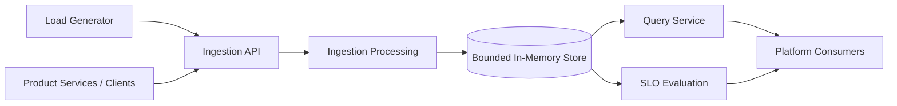

# ObsForge — Platform Observability Engine

[](https://openjdk.org/projects/jdk/21/)
[](#architecture)
[](https://openjdk.org/jeps/444)
[](LICENSE)

> A Java 21 platform observability project exploring telemetry ingestion, concurrent processing, bounded resource management, query APIs, and SLO/error-budget evaluation.

## Overview

**ObsForge** is a multi-module Java platform observability project designed to demonstrate core engineering concepts behind systems that collect, process, expose, and evaluate operational telemetry. It brings together a telemetry ingestion pipeline, virtual-thread-based request handling, bounded in-memory storage with back-pressure, a query-facing API, traffic simulation, and SLO/error-budget evaluation. The project focuses on engineering concerns that arise when building reliable internal platforms: throughput, resource limits, service boundaries, operational visibility, and measurable reliability.

## Why ObsForge exists

Modern engineering organisations need more than dashboards. Platform teams need dependable ways for product teams to understand service health, detect degradation, and make reliability measurable.

| Platform engineering concern | ObsForge capability |
|---|---|
| Telemetry collection | Ingestion interface for operational events or measurements |
| Concurrent request handling | Java 21 virtual threads |
| Resource protection | Bounded in-memory storage |
| Overload management | Back-pressure when storage capacity is reached |
| Internal platform APIs | Query Service for consuming telemetry |
| Traffic and capacity testing | Load generator for simulated application traffic |
| Reliability measurement | SLO evaluation and error-budget calculation |
| Modular system design | Separation of platform responsibilities across Java modules |

The project demonstrates how these concerns fit together in a focused platform. Performance and production-readiness claims should be supported by repeatable benchmarks and operational evidence.

## Architecture

See [the architecture diagrams](docs/architecture.md) for the high-level view, ingestion sequence, data flow, and SLO evaluation flow.



### Main components

- **Load Generator:** produces simulated telemetry traffic for development and testing.
- **Ingestion API:** accepts incoming telemetry requests.
- **Ingestion Processing:** validates and processes accepted events.
- **Bounded Store:** retains telemetry within a configured memory limit.
- **Query Service:** exposes a stable interface for retrieving telemetry.
- **SLO Evaluator:** evaluates service-level indicators against configured objectives and calculates error-budget consumption.

## Features

- Java 21 implementation.
- Multi-module project organisation.
- Concurrent ingestion using virtual threads.
- Bounded in-memory telemetry storage.
- Back-pressure to protect the system under load.
- Query API for downstream consumers.
- Simulated traffic generation.
- SLO evaluation and error-budget calculations.
- Local development and Docker Compose support, where configured.

## Technology stack

| Area | Technology |
|---|---|
| Language | Java 21 |
| Concurrency | Java virtual threads |
| Application framework | Spring Boot (confirm exact version) |
| Build | Maven or Gradle (confirm actual build tool) |
| API | HTTP/REST (confirm implementation) |
| Storage | Bounded in-memory store |
| Local environment | Docker / Docker Compose, if configured |
| Architecture | Multi-module application |
| Documentation | Markdown and Mermaid |

## Project structure

The following is a conceptual structure. Update the module names to match the actual build files before treating it as the definitive source tree.

```text
ObsForge/
├── README.md
├── LICENSE
├── .gitignore
├── pom.xml                    # If using Maven
├── docker-compose.yml         # If configured
├── Dockerfile                 # If configured
├── docs/
│   └── architecture.md
├── ingestion-service/
├── query-service/
├── telemetry-store/
├── slo-engine/
└── load-generator/
```

## Getting started

### Prerequisites

- JDK 21
- Maven or Gradle, depending on the project build
- Docker Desktop and Docker Compose, if using the container setup
- Git

Verify Java:

```bash
java -version
```

### Clone the repository

```bash
git clone https://github.com/Mjmuhiya/ObsForge.git
cd ObsForge
```

### Build locally

For a Maven multi-module project with Maven Wrapper:

```bash
./mvnw clean verify
```

On Windows PowerShell:

```powershell
.\mvnw.cmd clean verify
```

If the repository does not include the Maven Wrapper:

```bash
mvn clean verify
```

Start the relevant application module using its documented entry point. For example, if the ingestion module is a Spring Boot application:

```bash
./mvnw -pl ingestion-service spring-boot:run
```

> **Implementation note:** The module names and commands above are examples. Confirm them against the actual project before relying on them.

### Run with Docker Compose

If the repository contains a working Compose configuration:

```bash
docker compose up --build
docker compose ps
docker compose logs -f
```

Run in the background:

```bash
docker compose up --build -d
```

Stop the environment:

```bash
docker compose down
```

## API examples

The following examples illustrate the intended API usage. Replace the example routes, JSON fields, and port with the actual API contract before publishing them as verified endpoints.

### Submit telemetry

```bash
curl -X POST http://localhost:8080/api/v1/telemetry \
  -H "Content-Type: application/json" \
  -d '{
    "service": "checkout",
    "metric": "request.duration",
    "value": 125.5,
    "unit": "ms",
    "timestamp": "2026-01-15T10:30:00Z"
  }'
```

### Query telemetry

```bash
curl "http://localhost:8080/api/v1/telemetry?service=checkout"
```

### Evaluate an SLO

```bash
curl "http://localhost:8080/api/v1/slos/checkout"
```

> These are illustrative examples, not verified routes. Publish only paths and payloads implemented by the application.

## How the system works

1. **Traffic generation:** the load generator produces representative requests and telemetry events.
2. **Request ingestion:** clients submit telemetry through the ingestion interface.
3. **Validation:** incoming payloads are checked before entering the processing pipeline.
4. **Concurrent processing:** the application handles concurrent work using its configured concurrency model.
5. **Capacity protection:** the bounded store limits retained data and defines what happens when capacity is exhausted.
6. **Querying:** downstream consumers retrieve telemetry through the Query Service rather than depending directly on storage internals.
7. **Reliability evaluation:** the SLO component derives indicators from telemetry and compares them against configured objectives.
8. **Error-budget reporting:** the platform communicates how much of the permitted failure budget has been consumed.

## Engineering deep dive

### High-throughput ingestion

The ingestion path is the system's entry point and must balance request throughput with predictable resource consumption.

A useful ingestion design separates HTTP request handling, payload validation, event processing, storage admission, and response generation. This prevents transport concerns from becoming tightly coupled to storage implementation and makes it easier to measure where time is spent and where bottlenecks occur.

Throughput should be evaluated using repeatable tests that record request rate, latency percentiles, rejection rate, and resource consumption. A high request count alone is not evidence of a reliable ingestion system.

### Why Java 21 virtual threads?

Java 21 made virtual threads a standard feature. They make it practical to write thread-per-request or thread-per-task code for workloads involving substantial blocking I/O without requiring one operating-system thread for every concurrent task.

For ObsForge, virtual threads provide an opportunity to explore a simpler concurrency model for request-oriented work, large numbers of concurrent tasks, and reduced dependence on manually managed thread pools for blocking workloads.

Virtual threads do not make CPU-intensive work automatically faster, eliminate the need for limits, or guarantee higher throughput. The application still needs bounded queues, resource limits, sensible timeouts, and load testing.

### Bounded in-memory storage and back-pressure

An unbounded in-memory collection can continue accepting data until the application experiences excessive memory pressure or an out-of-memory failure.

A bounded store introduces an explicit capacity limit. Once that limit is reached, the ingestion path must apply a defined overload policy rather than accepting unlimited work. Possible policies include rejecting new events, waiting for capacity for a controlled period, dropping data according to a documented policy, or applying upstream rate limits.

The important design principle is that overload must be visible and predictable. Back-pressure protects downstream resources by communicating that the consumer cannot currently accept more work.

For a production-oriented implementation, document the capacity configuration, concurrency guarantees, admission policy, and shutdown behaviour.

### Query Service as a platform API

The Query Service provides a stable interface between telemetry storage and product teams. Instead of allowing each consumer to depend on internal storage structures, it centralises query behaviour and provides a controlled API boundary.

This enables consistent filtering and retrieval semantics, validation of query parameters, a clear place for pagination and time-window support, and future changes to storage without forcing every consumer to change. A mature platform API should document its contract, error responses, time-window semantics, and compatibility expectations.

### SLOs and error budgets

A Service Level Indicator (SLI) is a measured representation of service behaviour. A Service Level Objective (SLO) defines the target for that indicator over a specified period.

For an availability-style SLO:

```text
SLI = Good Events / Total Eligible Events
Error Budget Allowance = 1 - SLO Target
Budget Consumed = Bad Events / Total Eligible Events
Budget Remaining = Error Budget Allowance - Budget Consumed
```

For example, with a 99.9% availability target, the permitted failure ratio is 0.1%. The actual calculation must use a consistent event definition and evaluation window. Latency-based SLOs require a suitable threshold or distribution-based measurement; they should not be calculated as if they were simple availability ratios.

The value of an error budget is operational: it helps teams balance feature delivery against reliability work using measurable evidence.

### Load generator and traffic simulation

A load generator provides controlled traffic so that ingestion and query paths can be exercised under repeatable conditions.

Useful traffic patterns include constant-rate traffic to establish a baseline, gradually increasing traffic to identify capacity limits, burst traffic to test overload behaviour, mixed service traffic to test filtering and isolation, and invalid requests to verify validation.

A useful performance report should include requests attempted and accepted, requests rejected or failed, throughput (requests per second), p50/p95/p99 latency, error rate, CPU and memory utilisation, store occupancy, and back-pressure events.

Avoid publishing benchmark numbers unless they were measured on a documented environment with repeatable test parameters.

## Design decisions and trade-offs

| Decision | Benefit | Trade-off / consideration |
|---|---|---|
| Java 21 virtual threads | Simplifies concurrent blocking request handling | Does not remove the need for admission control or CPU capacity planning |
| Bounded in-memory storage | Predictable memory ceiling | Data is volatile and capacity is finite |
| Back-pressure | Makes overload explicit and protects resources | Clients need clear retry and failure semantics |
| Separate Query Service | Decouples consumers from storage internals | Adds an API boundary and its own operational concerns |
| Modular project structure | Improves separation of responsibilities | Requires clear module contracts and dependency management |
| Load generator | Enables repeatable local experiments | Simulated traffic does not fully represent production workloads |

## Roadmap

- [ ] Add repeatable ingestion benchmarks and publish methodology.
- [ ] Add latency percentile reporting.
- [ ] Add persistent telemetry storage.
- [ ] Add Prometheus-compatible metrics and Grafana dashboards.
- [ ] Add distributed tracing and correlation IDs.
- [ ] Add authentication and role-based access control.
- [ ] Add configurable retention and time-window queries.
- [ ] Add multi-instance deployment and horizontal scaling.
- [ ] Add automated integration and load tests.
- [ ] Add CI quality gates and dependency scanning.
- [ ] Add Kubernetes deployment examples and operational runbooks.

## Testing

For Maven:

```bash
./mvnw test
./mvnw clean verify
```

Add integration-test and load-test commands once the actual build profiles and test modules are confirmed.

## Contributing

Contributions and engineering feedback are welcome. Please open an issue to discuss significant changes before submitting a pull request.

When contributing, include the problem being addressed, the design decision and its trade-offs, tests or repeatable validation steps, and operational or compatibility implications.

## License

This project is licensed under the MIT License. See [LICENSE](LICENSE) for details.

---

**ObsForge** — exploring the engineering foundations of reliable, observable platforms.
