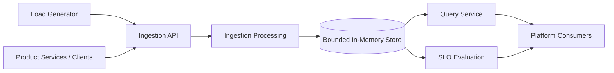
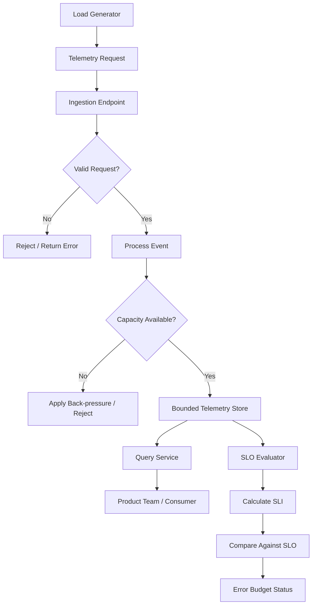
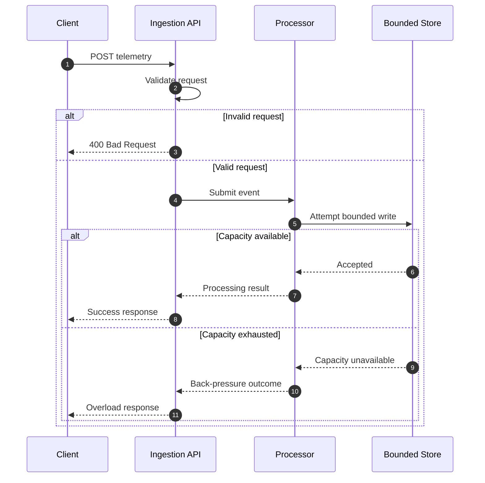
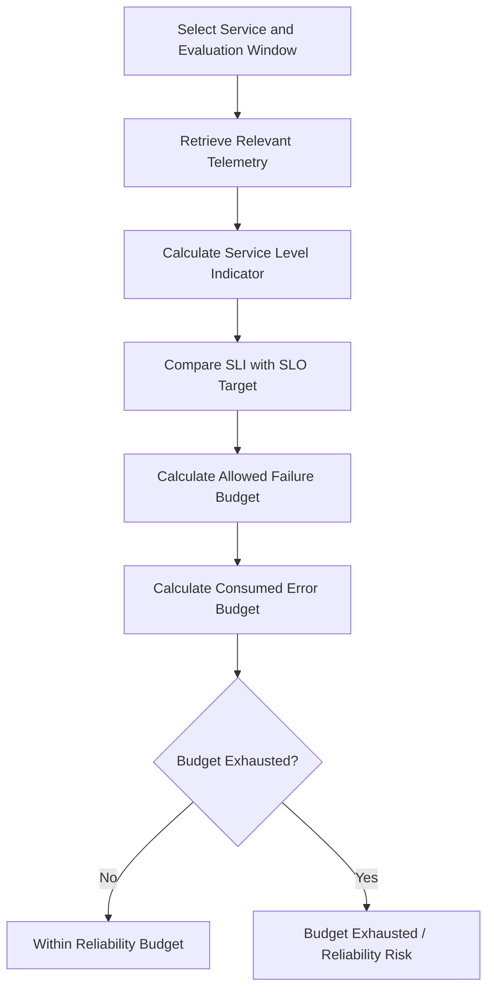

# ObsForge Architecture

This document captures the conceptual architecture and principal flows of ObsForge. Update component names and interfaces to match the implementation as it evolves.

## 1. High-level system architecture

## 2. Telemetry data flow

## 3. Ingestion request sequence

## 4. SLO and error-budget evaluation

## Architectural principles

- **Explicit resource limits:** bounded storage makes capacity constraints visible.
- **Controlled overload:** back-pressure defines how the system behaves when consumers cannot keep up.
- **Separation of concerns:** ingestion, storage, querying, traffic generation, and SLO evaluation have distinct responsibilities.
- **Stable consumer boundary:** product teams interact through a query-facing API rather than storage internals.
- **Measurable reliability:** SLOs and error budgets turn telemetry into operational signals.

> These diagrams describe the intended conceptual design. Revise them whenever the implementation's module boundaries, request lifecycle, or storage behaviour differ.
